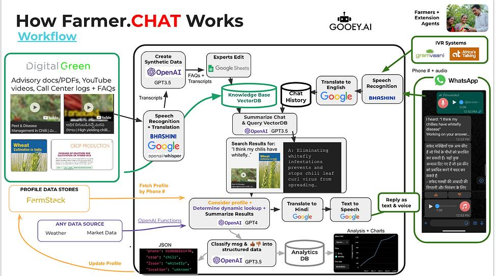

# 🌾 AI Agriculture Advisor — RAG-Powered MVP

<p align="center">
  
</p>

<p align="center">
  <b>Evidence-based agricultural guidance for Ethiopian farmers, powered by Retrieval-Augmented Generation (RAG)</b><br/>
  English · Amharic · Tigrigna
</p>

---

## 📖 Table of Contents
1. [Overview](#overview)
2. [Architecture](#architecture)
3. [Workflow](#workflow)
4. [Features](#features)
5. [Tech Stack](#tech-stack)
6. [Project Structure](#project-structure)
7. [Quick Start](#quick-start)
8. [API Reference](#api-reference)
9. [Language Support](#language-support)
10. [Design System](#design-system)
11. [Logging & Monitoring](#logging--monitoring)
12. [Configuration](#configuration)
13. [Roadmap](#roadmap)
14. [Disclaimer](#disclaimer)

---

## Overview

**AI Agriculture Advisor** is an open-source, RAG-based chatbot that delivers precise, context-grounded answers to farmers' questions about crop cultivation — starting with **Teff** and **Maize** in Ethiopia, with a roadmap toward pan-African coverage.

Unlike generic LLMs that hallucinate agronomic advice, this system answers **only from trusted agricultural manuals** (FAO publications and Ethiopian Ministry of Agriculture documents), refusing to speculate when the documents don't contain the answer.

Key differentiators:
- 🌍 **Multilingual** — detects Ge'ez script automatically; queries and answers flow in Amharic/Tigrigna or English
- 📚 **Grounded** — every answer is backed by retrieved document chunks shown in a collapsible sources panel
- 🔁 **Feedback loop** — thumbs up/down ratings are logged to continuously improve the knowledge base
- ⚡ **Fast** — SQLite response cache avoids redundant ML inference for repeated questions
- 🔒 **Safe** — hardcoded system prompt prevents prompt injection and keeps the model on-topic

---

## Architecture

```
┌────────────────────────────────────────────────────┐
│                  User Browser                      │
│   React SPA (localhost:3000)                       │
│   WelcomePage → ChatPage → AboutUs → ContactUs     │
└───────────────────┬────────────────────────────────┘
                    │ POST /ask  { question, k, translate_local }
                    ▼
┌────────────────────────────────────────────────────┐
│            FastAPI Backend  (localhost:8000)        │
│                                                    │
│  1. CacheService     → SQLite lookup (hit → return) │
│  2. TranslationService → detect Ge'ez → EN         │
│  3. RAGService       → POST remote_url/ask          │
│  4. TranslationService → answer back to AM/TI       │
│  5. CacheService     → store response               │
│  6. LoggingService   → append JSONL log             │
└───────────────────┬────────────────────────────────┘
                    │ POST /ask  { question, k }
                    ▼
┌────────────────────────────────────────────────────┐
│         Remote ML Service  (rag_check.py)          │
│                                                    │
│  SentenceTransformer (multilingual-MiniLM-L12-v2)  │
│          ↓  embed query                            │
│  FAISS Index  ← chunks.jsonl                       │
│          ↓  top-k retrieval                        │
│  google/flan-t5-small  → generate answer           │
│          ↓                                         │
│  return { answer, sources[] }                      │
└────────────────────────────────────────────────────┘
```

---

## Workflow

The diagram below illustrates the end-to-end request lifecycle — from the moment a farmer types a question to the moment a grounded answer appears on screen.

<p align="center">
  
</p>

| Step | Component | What Happens |
|------|-----------|--------------|
| 1 | React `ChatPage` | User types question (English or Amharic/Tigrigna) |
| 2 | `ChatPage` | Ge'ez script regex check → sets `translate_local` flag |
| 3 | FastAPI `/ask` | Cache lookup — if hit, returns immediately |
| 4 | `TranslationService` | `detect_geez_script()` → translates to English if needed |
| 5 | `RAGService` | POSTs to remote ML service with retry (up to 3×, exponential backoff) |
| 6 | Remote ML | Embeds question → FAISS top-k search → flan-t5 answer generation |
| 7 | `RAGService` | Normalizes sources to `{text, metadata}` structure |
| 8 | `TranslationService` | Translates answer back to original language |
| 9 | `CacheService` | Stores response in SQLite for future identical queries |
| 10 | `LoggingService` | Appends full record to `query_log.jsonl` |
| 11 | React `MessageBubble` | Displays answer + collapsible `SourcesPanel` + `FeedbackBar` |
| 12 | `FeedbackBar` | User submits thumbs up/down → `POST /feedback` → `feedback_log.jsonl` |

---

## Features

### 🤖 Backend
| Feature | Description |
|---------|-------------|
| RAG Pipeline | Remote ML service with multilingual sentence-transformer embeddings + FAISS vector search + flan-t5 generation |
| Multilingual | Ge'ez script detection; transparent Amharic/Tigrigna ↔ English translation |
| Response Cache | SQLite-backed key-value store; avoids repeated ML calls for identical queries |
| Structured Logging | JSONL logs for every query, feedback submission, and error — production-ready audit trail |
| Retry Logic | Up to 3 retries with exponential back-off when the remote ML service is slow/unavailable |
| Graceful Degradation | `/chat` never returns HTTP 500 — always returns a safe fallback response |
| Feedback API | `POST /feedback` stores 1–5 star ratings with optional comment |
| Debug Endpoints | `/debug/remote_preview` and `/rag_status` for live diagnostics |

### 🖥️ Frontend
| Feature | Description |
|---------|-------------|
| Responsive Chat UI | Mobile-first design with Tailwind CSS; works on phones, tablets, and desktops |
| Suggestion Chips | Three one-click starter questions on empty state |
| Collapsible Sources | Every assistant message shows its retrieved document chunks |
| Feedback Bar | Thumbs up/down per message; sends rating to backend |
| Typing Indicator | Animated three-dot pulse during response loading |
| Toast Notifications | Error toasts with auto-dismiss |
| Multi-page App | Welcome, Chat, About, Contact pages via React Router |
| Auto-resize Input | Textarea grows with content (1–150px), Shift+Enter for newline |

---

## Tech Stack

### Backend
| Layer | Technology |
|-------|-----------|
| Framework | FastAPI 0.100+ |
| Server | Uvicorn (ASGI) |
| Validation | Pydantic v2 |
| Config | python-dotenv |
| Cache | SQLite (stdlib) |
| HTTP client | requests + urllib3 |
| ML — Embeddings | `sentence-transformers` (paraphrase-multilingual-MiniLM-L12-v2) |
| ML — Vector search | FAISS |
| ML — Generation | HuggingFace `transformers` (google/flan-t5-small) |
| ML — Inference | PyTorch |
| Translation | googletrans / deep-translator |

### Frontend
| Layer | Technology |
|-------|-----------|
| Framework | React 18 |
| Language | TypeScript |
| Routing | React Router v7 |
| Styling | Tailwind CSS v3 |
| Icons | lucide-react |
| Build | Create React App (react-scripts 5) |

---

## Project Structure

```
farmer-advisor-ai/
│
├── README.md                        # ← You are here
│
├── backend/
│   ├── app/
│   │   └── main.py                  # FastAPI app — all endpoints & pipeline logic
│   ├── services/
│   │   ├── rag_service.py           # Remote RAG client with retry
│   │   ├── translation_service.py   # Ge'ez detection + stub translation
│   │   ├── cache_service.py         # SQLite key-value cache
│   │   ├── logging_service.py       # JSONL logging (queries, feedback, errors)
│   │   └── env_utils.py             # Environment variable helpers
│   ├── scripts/
│   │   └── rag_check.py             # Full local ML pipeline (FAISS + flan-t5)
│   ├── data/
│   │   └── chunks/
│   │       └── chunks.jsonl         # Pre-processed agricultural document chunks
│   ├── logs/
│   │   ├── query_log.jsonl          # Every query + answer
│   │   ├── feedback_log.jsonl       # User ratings
│   │   └── error_log.jsonl          # Errors
│   ├── requirements.txt
│   └── README.md
│
├── frontend/
│   ├── public/
│   │   ├── index.html
│   │   └── workflow-image.jpg       # System workflow diagram
│   ├── src/
│   │   ├── App.tsx                  # Router + page layout
│   │   ├── components/
│   │   │   ├── WelcomePage.tsx      # Hero landing page
│   │   │   ├── ChatPage.tsx         # Chat orchestrator
│   │   │   ├── ChatWindow.tsx       # Scrollable message list
│   │   │   ├── MessageBubble.tsx    # Single message renderer
│   │   │   ├── InputBar.tsx         # Auto-resizing textarea + send
│   │   │   ├── SourcesPanel.tsx     # Collapsible document sources
│   │   │   ├── FeedbackBar.tsx      # Thumbs up/down per message
│   │   │   ├── Navigation.tsx       # Top nav bar
│   │   │   ├── AboutUs.tsx          # About page
│   │   │   ├── ContactUs.tsx        # Contact form
│   │   │   ├── TypingIndicator.tsx  # Three-dot animation
│   │   │   ├── Toast.tsx            # Auto-dismiss notifications
│   │   │   ├── Modal.tsx            # Generic modal dialog
│   │   │   ├── ChatHeader.tsx       # Standalone chat header
│   │   │   └── ui/                  # Shadcn-style primitives
│   │   │       ├── button.tsx
│   │   │       ├── card.tsx
│   │   │       ├── input.tsx
│   │   │       ├── scroll-area.tsx
│   │   │       └── skeleton.tsx
│   │   └── index.tsx
│   ├── package.json
│   ├── tailwind.config.js
│   ├── tsconfig.json
│   └── README.md
│
├── evaluation/
│   └── questions.jsonl              # Evaluation question set
│
└── requirements.txt                 # Root-level Python deps (alias)
```

---

## Quick Start

### Prerequisites
- Python 3.9+
- Node.js 18+
- npm 9+

### 1. Clone the repository
```bash
git clone https://github.com/abrsh21son/Farmer-Advisor-AI.git
cd Farmer-Advisor-AI
```

### 2. Backend Setup
```bash
cd backend
pip install -r requirements.txt
```

Create a `.env` file in the project root:
```env
RAG_REMOTE_URL=http://your-ml-service-host:port
RAG_REMOTE_TIMEOUT=120
RAG_MAX_RETRIES=3
RAG_ENABLE_FALLBACK=false
DEBUG_MODE=false
```

Start the FastAPI server:
```bash
python -m uvicorn backend.app.main:app --reload --host 0.0.0.0 --port 8000
```

### 3. Remote ML Service (optional — local run)
```bash
# From backend/scripts/
uvicorn rag_check:app --host 0.0.0.0 --port 8001
# Then set RAG_REMOTE_URL=http://localhost:8001 in .env
```

### 4. Frontend Setup
```bash
cd frontend
npm install
npm start
```

The app opens at **http://localhost:3000**

---

## API Reference

### `POST /ask` (or `/chat`)
Main query endpoint.

**Request**
```json
{
  "question": "When is the best time to plant teff in Tigray?",
  "k": 3,
  "translate_local": false
}
```

**Response**
```json
{
  "answer": "Teff is typically planted at the onset of the main rainy season (June–July in most highland areas)...",
  "backend": "remote",
  "sources": [
    {
      "text": "...teff sowing should coincide with the first reliable rains...",
      "metadata": { "crop": "teff", "source": "FAO-Teff-Manual-2018", "page": 12 }
    }
  ],
  "question_id": "3f8a1b2c-...",
  "answer_local": null,
  "confidence": null
}
```

### `POST /feedback`
Submit a rating for a received answer.

```json
{
  "question_id": "3f8a1b2c-...",
  "rating": 5,
  "comment": "Exactly what I needed!"
}
```

### `GET /health`
```json
{
  "status": "healthy",
  "timestamp": "2024-11-06T10:23:45.123456",
  "service": "agri-advisor-api",
  "ml_online": true,
  "remote_url": "http://ml-service:8001"
}
```

### `GET /rag_status`
```json
{
  "initialized": true,
  "mock_mode": false,
  "chunks_loaded": 0,
  "index_count": null,
  "backend": "remote"
}
```

### `POST /debug/remote_preview`
Hits the remote RAG service directly and returns the raw response (useful for debugging without cache/translation layers).

---

## Language Support

| Language | Script | Detection Method | Notes |
|----------|--------|-----------------|-------|
| English | Latin | Default | No translation needed |
| Amharic (አማርኛ) | Ge'ez/Ethiopic | Unicode range `\u1200–\u137F` | Auto-translated to EN for retrieval, answer translated back |
| Tigrigna (ትግርኛ) | Ge'ez/Ethiopic | Same as Amharic | Same translation flow |

Translation pipeline: `User query (AM/TI)` → `TranslationService.translate_to_english()` → `RAG retrieval (EN)` → `TranslationService.translate_from_english()` → `User answer (AM/TI)`

> **Note:** The current `TranslationService` is a stub that returns text unchanged. Connect a real translation provider (e.g., Google Translate API, Helsinki-NLP models) for full multilingual support.

---

## Design System

### Color Palette
| Token | Value | Usage |
|-------|-------|-------|
| Background | `#F6FBF7` | Page backgrounds |
| Assistant bubble | `#E6F8ED` | Bot message cards |
| User bubble | `#2F9E44` | User message pills |
| Accent | `#60A664` | Buttons, highlights |
| Dark text | `#0B2B17` | Headings, body text |
| Border | `green-200` | Card borders |

### Typography
- **Headings:** Inter (system fallback)
- **Body:** Inter / Noto Sans Ethiopic (for Ge'ez script rendering)

### Animation
| Effect | Duration | Usage |
|--------|----------|-------|
| Fade-in | 300ms ease | New messages |
| Slide-up | 200ms ease | Toast notifications |
| Pulse | 1.2s loop | Typing indicator dots |

---

## Logging & Monitoring

All activity is logged as newline-delimited JSON (JSONL) in `backend/logs/`:

**`query_log.jsonl`** — one record per query
```json
{
  "timestamp": "2024-11-06T10:23:45.123456",
  "question_id": "uuid",
  "question": "How do I control fall armyworm in maize?",
  "answer": "Fall armyworm (Spodoptera frugiperda) can be controlled...",
  "sources": [...],
  "backend": "remote",
  "translated": false,
  "detected_language": "en",
  "from_cache": false
}
```

**`feedback_log.jsonl`** — one record per feedback submission
```json
{ "timestamp": "...", "question_id": "uuid", "rating": 5, "comment": "Very helpful!" }
```

**`error_log.jsonl`** — one record per caught exception
```json
{ "timestamp": "...", "question_id": "uuid", "error": "Connection refused to remote ML service" }
```

---

## Configuration

All configuration is via environment variables (`.env` file at project root):

| Variable | Default | Description |
|----------|---------|-------------|
| `RAG_REMOTE_URL` | — | URL of the remote ML service (required) |
| `RAG_REMOTE_TIMEOUT` | `120` | Request timeout in seconds |
| `RAG_MAX_RETRIES` | `3` | Max retry attempts on remote failure |
| `RAG_ENABLE_FALLBACK` | `false` | Enable mock response fallback |
| `DEBUG_MODE` | `false` | Include exception details in 500 responses |

---

## Roadmap

- [ ] Integrate real Google Translate / Helsinki-NLP translation models
- [ ] Add Oromo language support
- [ ] Expand knowledge base to additional crops (wheat, sorghum, barley)
- [ ] Implement TTL-based cache expiry
- [ ] Add vector store refresh pipeline (new document ingestion)
- [ ] Deploy backend to AWS / Railway with CI/CD
- [ ] Mobile app (React Native) for offline-capable usage
- [ ] Admin dashboard for log analysis and feedback review
- [ ] Pan-African expansion (Swahili, Hausa, Yoruba)

---

## Disclaimer

This system provides **advisory information only**. All answers are derived from the loaded agricultural documents and should not replace advice from qualified agronomists or local agricultural extension services. Always verify critical farming decisions with domain experts.

---

<p align="center">
  Built with ❤️ for Ethiopian farmers &nbsp;·&nbsp; Ethiopia → Africa → Global
</p>

<!-- README version: 1.1.0 -->


## Contributing

See [CONTRIBUTING.md](CONTRIBUTING.md) for how to report issues and submit pull requests.